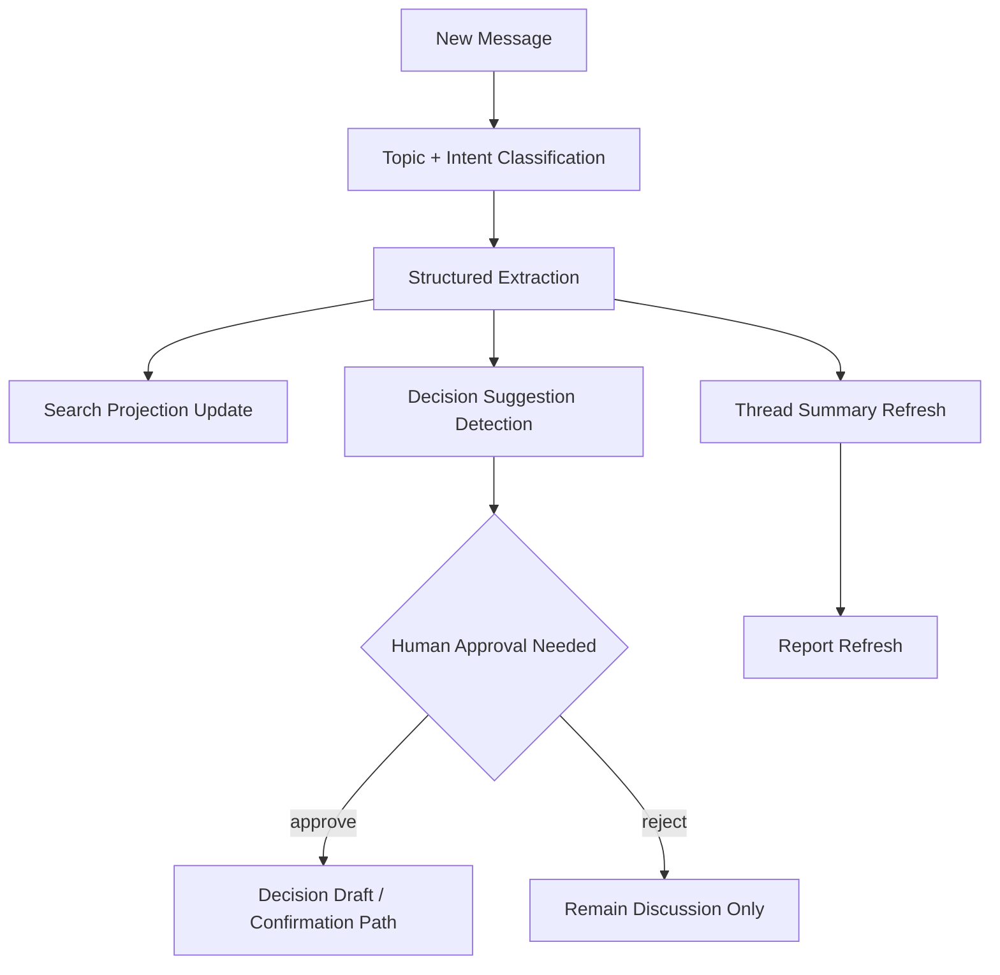

# AI Pipeline

This document defines the MVP AI pipeline for Dudecide.

## AI Product Role

AI is an assistant for structure and recall, not the final decision maker.

It should:

- classify conversation into useful planning structure
- reduce summarization effort
- highlight likely decisions and blockers
- provide evidence-backed search and report support

It must not:

- finalize decisions without human confirmation
- hide meaningful dissent
- invent evidence or rationale

## Pipeline Overview



## Input Units

### Primary

- single message
- short sliding context window around message
- thread metadata
- meeting metadata

### Optional Context

- active decisions in the same meeting
- active vote results
- latest thread summary

## Stage 1: Topic Classification

Output one or more labels:

- `date`
- `location`
- `lodging`
- `transport`
- `budget`
- `tasking`
- `free_chat`

Rules:

- preserve multi-label capability when a message spans domains
- prefer thread context when confidence is low
- do not force non-decision chatter into decision-heavy topics

## Stage 2: Intent Classification

Possible intents:

- `proposal`
- `support`
- `opposition`
- `condition`
- `confirmation`
- `task`
- `question`
- `chatter`

Requirements:

- support multiple intents per message when necessary
- surface confidence score
- log model version used

## Stage 3: Structured Extraction

Extract normalized fields when present:

- dates and ranges
- place names
- budget values
- people and responsibilities
- preferences and constraints
- explicit objections
- action items

### Output Contract

```json
{
  "messageId": "message_123",
  "topics": ["date"],
  "intents": ["proposal", "condition"],
  "entities": {
    "dates": ["2026-07-18"],
    "constraints": ["after 6pm departure"],
    "people": ["Kim"]
  },
  "confidence": 0.87,
  "modelVersion": "classifier-v1"
}
```

## Stage 4: Summary Refresh

The summary job should produce:

- current options
- support and opposition points
- unresolved blockers
- next action suggestion
- linked source message ids

### Summary Types

- `thread_snapshot`
- `decision_digest`
- `search_answer_snippet`

## Stage 5: Decision Suggestion

The system should detect language patterns suggesting closure:

- "let's finalize this"
- "then let's go with this"
- "confirmed"
- "we decided on"

The output should create a draft suggestion, not a final decision.

### Decision Suggestion Shape

```json
{
  "decisionType": "location",
  "title": "Trip location",
  "proposedResult": {
    "region": "Sancheong",
    "activity": "rafting"
  },
  "evidenceMessageIds": ["message_1", "message_2"],
  "confidence": 0.91
}
```

## Evidence Policy

Every generated summary or suggestion that can influence a user decision must carry evidence references.

Minimum:

- source message ids
- quote snapshot for surfaced evidence
- extraction confidence

Recommended:

- explanation of why each evidence item was selected

## Search Integration

After extraction:

- build or update searchable documents
- attach semantic tags
- generate embeddings for message, summary, and decision text

Hybrid search should combine:

- keyword matches
- semantic similarity
- recency
- decision relevance

## Human Review Points

Mandatory human confirmation for:

- decision confirmation
- vote closure override when based on AI recommendation
- report publication if AI generated a high-level narrative summary

Optional human review for:

- thread summaries
- candidate deduplication suggestions

## Failure Handling

### Low Confidence

- show raw conversation rather than strong AI claims
- avoid auto-creating decision drafts

### Model Outage

- core meeting, thread, vote, and decision features still function
- defer summaries and semantic indexing into retry queues

### Contradictory Evidence

- surface disagreement explicitly
- do not flatten into a false consensus summary

## Prompting And Evaluation

### Prompt Design Requirements

- explicit schema output
- no hidden finalization behavior
- preserve dissent and uncertainty
- include only minimal necessary context for privacy and cost

### Evaluation Set

Build a repository-local evaluation dataset with:

- ambiguous date statements
- mixed chatter and decision content
- opposition-heavy location debates
- multilingual or shorthand conversation fragments

### Metrics

- topic classification accuracy
- intent classification accuracy
- extraction precision for date and location entities
- summary evidence coverage
- decision suggestion precision

## Model Boundary Recommendation

Use smaller structured models for classification and extraction when possible, and reserve larger reasoning calls for:

- summary generation
- semantic search answer composition
- report narrative generation

## Auditability

Store for each AI artifact:

- model name
- model version
- prompt template version
- confidence
- source message ids
- generation timestamp

This is required to debug trust failures later.
