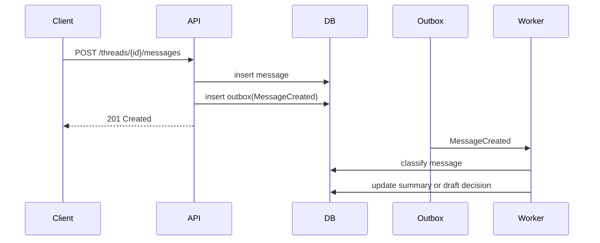
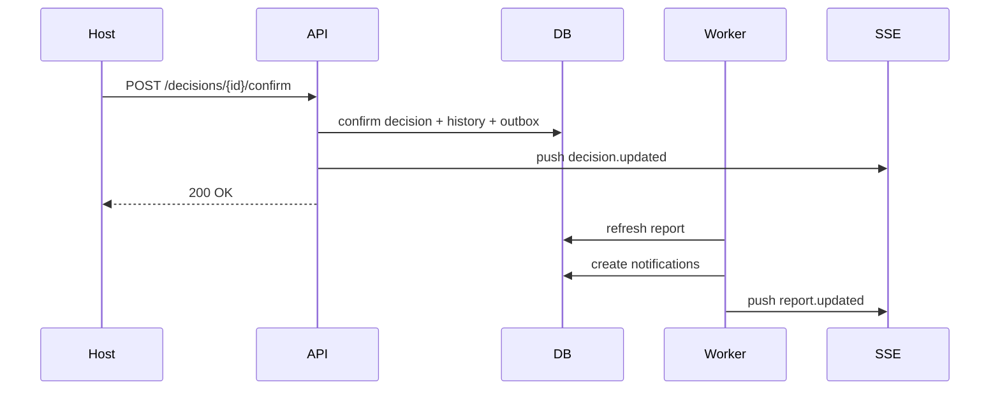

# API And Events

This document defines the MVP external API surface and internal async events.

## API Style

- REST for core domain operations
- SSE for room timeline updates
- JSON request and response bodies
- idempotency support for key mutation endpoints where retries are likely

## Versioning

- initial namespace: `/api/v1`
- breaking changes should use additive migration where possible during MVP

## Auth Model

- current implementation resolves callers in this order: HTTP session, development headers, then local host fallback
- `POST /api/v1/auth/guest-sessions` creates a local guest-backed session
- `GET /api/v1/auth/me` returns the currently resolved actor
- `DELETE /api/v1/auth/session` clears the current local session
- `X-Actor-Id` selects the caller user identity and auto-provisions the user row if needed
- `X-Actor-Name` updates or seeds the caller display name for local development
- invite token join creates guest membership records and also binds the joined user into the current HTTP session
- meeting-scope authorization is enforced through membership role checks
- signed production-grade sessions and external identity proof remain follow-up work

## Core Resources

- meetings
- invite-links
- memberships
- threads
- messages
- decisions
- votes
- reports
- search
- notifications

## Implemented Surface

### Auth

`POST /api/v1/auth/guest-sessions`

- create a local guest-backed session

`GET /api/v1/auth/me`

- resolve the current actor from session, header, or local fallback

`DELETE /api/v1/auth/session`

- clear the current HTTP session

### Meetings

`POST /api/v1/meetings`

- create meeting

`GET /api/v1/meetings/{meetingId}`

- get meeting summary and progress
- returns thread-level counts so the client can render planning progress without separate summary calls
- requires meeting membership

`PATCH /api/v1/meetings/{meetingId}`

- update meeting metadata and status
- requires `host` or `co_host`

### Invites And Membership

`POST /api/v1/meetings/{meetingId}/invite-links`

- create invite link
- requires `host` or `co_host`

`POST /api/v1/invite-links/{token}/join`

- join via invite

`PATCH /api/v1/meetings/{meetingId}/members/{memberId}`

- update role or attendance state
- requires `host` or `co_host`

### Threads And Messages

`GET /api/v1/meetings/{meetingId}/threads`

- list threads with badges and activity state
- each thread reports `readOnly`; import threads are read-only
- requires meeting membership

`POST /api/v1/meetings/{meetingId}/threads`

- create thread
- requires `host` or `co_host`

`GET /api/v1/threads/{threadId}/messages`

- list paginated messages
- supports `before=<ISO-8601 timestamp>` cursor pagination
- supports `limit=<1-100>` with default `50`
- returns each page in chronological order
- each message carries `origin` (`native` or `imported`) and a resolved `speaker`; `senderUserId` is null for imported messages
- imported speaker label: member display name when the speaker is mapped, the exported name for the import uploader, otherwise the pseudonym with `pseudonymized = true`
- requires meeting membership

`POST /api/v1/threads/{threadId}/messages`

- post message
- writes `MessageCreated` into the outbox for downstream AI and notification workers
- returns `422` when the thread is read-only
- requires meeting membership

`PATCH /api/v1/messages/{messageId}`

- edit message
- allowed for the original sender, `host`, or `co_host`
- returns `422` for imported messages

### Chat Imports

Design: [`chat-import-design.md`](./chat-import-design.md).

`POST /api/v1/imports`

- import a normalized, masked chat into a new draft meeting owned by the caller (guest session is enough)
- sets `purge_at` to 7 days later until the import is applied
- supports `Idempotency-Key`
- returns `202 Accepted` with `importId`, `meetingId`, `threadId`, `status`, `messageCount`, `duplicateCount`

`POST /api/v1/meetings/{meetingId}/imports`

- import into an existing meeting; messages already in the same source room thread are skipped by content hash
- returns `409` when every message was already imported
- supports `Idempotency-Key`
- requires `host` or `co_host`

`GET /api/v1/meetings/{meetingId}/imports`

- list imports, newest first
- requires meeting membership

`GET /api/v1/imports/{importId}`

- import status, progress, and staged result
- requires meeting membership

`GET /api/v1/imports/{importId}/evidence`

- messages cited by the staged result (evidence and objections), chronological, with the same speaker visibility as the thread view
- avoids paging the import thread, whose minute-precision timestamps make the `before` cursor skip messages
- requires meeting membership

`POST /api/v1/imports/{importId}/apply`

- apply selected staged `itemIds`: decisions become `proposed` (likely decided) or `in_discussion` with evidence; tasks are created; nothing is confirmed
- already applied items are reported in `skippedItemIds`; `open_question` and `abandoned` items return `400`; an import that is not `ready` or `applied` returns `409`
- moves a draft meeting to `active`, clears `purge_at`, refreshes the report
- supports `Idempotency-Key`
- requires `host` or `co_host`

`DELETE /api/v1/imports/{importId}`

- removes the import's messages; dependent decision evidence cascades and task sources are cleared; the import stays as a `deleted` tombstone
- `GET /api/v1/imports/{importId}?includeDeletionImpact=true` previews `removedMessages`, `removedEvidence`, `affectedConfirmedDecisions`
- allowed for the uploader, `host`, or `co_host`

`GET /api/v1/meetings/{meetingId}/import-speakers`

- list speakers with `label` (member name or pseudonym) and mapping; `displayName` and `pseudonym` only for `host`, `co_host`, and the thread uploader
- requires meeting membership

`PATCH /api/v1/import-speakers/{speakerId}`

- set or clear `membershipId`
- requires `host` or `co_host`

`POST /api/v1/meetings/{meetingId}/import-speakers/claim`

- the caller types their messenger name; all unmapped speakers in the meeting with that name map to the caller
- `404` when nothing matches, `409` when the caller already claimed a different name
- requires meeting membership

Limits (both create endpoints): `400` when consent is missing, the source type is not `kakao_export` or `paste`, the range exceeds 90 days, a message falls outside the range, or there are more than 3,000 messages or 200 speakers; the reason names the limit. `413` when the body exceeds 2 MB. Message bodies are truncated to 4,000 characters.

### Decisions

`GET /api/v1/meetings/{meetingId}/decisions`

- list decision board items
- requires meeting membership

`POST /api/v1/meetings/{meetingId}/decisions`

- create manual or AI-originated draft decision
- requires `host` or `co_host`

`GET /api/v1/decisions/{decisionId}`

- get decision detail with evidence and history
- requires meeting membership

`POST /api/v1/decisions/{decisionId}/confirm`

- confirm decision
- requires `host` or `co_host`

`POST /api/v1/decisions/{decisionId}/reconsider`

- reopen a confirmed decision with reason
- requires `host` or `co_host`

`POST /api/v1/decisions/{decisionId}/evidence`

- link a thread message as decision evidence
- requires `host` or `co_host`

### Votes

`POST /api/v1/meetings/{meetingId}/votes`

- create vote
- creates a linked decision automatically when `decisionId` is omitted
- stores deterministic scoring-rule metadata on the vote row
- requires `host` or `co_host`

`GET /api/v1/votes/{voteId}`

- get vote status and aggregated results
- returns option metadata, caller's current responses, and aggregate ranking snapshot
- requires meeting membership

`PUT /api/v1/votes/{voteId}/responses/me`

- submit or replace caller responses
- requires meeting membership

`POST /api/v1/votes/{voteId}/close`

- manually close vote
- freezes `closed_at` and persists a decision-facing vote snapshot into `decision.proposed_result`
- requires `host` or `co_host`

### Search And Reports

`GET /api/v1/meetings/{meetingId}/search?q=...`

- current implementation performs keyword search across messages, decisions, and tasks
- semantic search remains follow-up work
- requires meeting membership

`GET /api/v1/meetings/{meetingId}/tasks`

- list meeting tasks
- requires meeting membership

`POST /api/v1/meetings/{meetingId}/tasks`

- create task
- requires `host` or `co_host`

`PATCH /api/v1/tasks/{taskId}`

- update task title, status, owner, or due date
- requires `host` or `co_host`

`GET /api/v1/meetings/{meetingId}/notifications`

- list notifications for the current local actor
- requires meeting membership

`GET /api/v1/meetings/{meetingId}/reports/latest`

- get latest materialized report
- requires meeting membership

`POST /api/v1/meetings/{meetingId}/reports/refresh`

- trigger report regeneration
- requires `host` or `co_host`

### Realtime

`GET /api/v1/meetings/{meetingId}/events`

- SSE stream for room events
- current implementation is in-memory per application instance
- reconnect replay and broker-backed fan-out remain follow-up work
- requires meeting membership

## Sample Shapes

### Create Meeting Request

```json
{
  "title": "2026 Summer Rafting",
  "meetingType": "trip",
  "expectedHeadcount": 9,
  "originRegion": "Daegu",
  "budget": {
    "min": 150000,
    "max": 200000
  }
}
```

### Decision Detail Response

```json
{
  "id": "decision_123",
  "meetingId": "meeting_123",
  "threadId": "thread_123",
  "decisionType": "date",
  "title": "Trip date",
  "status": "confirmed",
  "confirmedResult": {
    "startDate": "2026-07-18",
    "endDate": "2026-07-19"
  },
  "evidence": [
    {
      "id": "evidence_123",
      "messageId": "message_123",
      "evidenceType": "vote_result",
      "quoteSnapshot": "8 of 9 participants can attend on 7/18",
      "confidence": 0.98
    }
  ],
  "history": [
    {
      "action": "confirmed",
      "reason": "No hard conflicts remained",
      "createdAt": "2026-08-07T10:00:00Z"
    }
  ]
}
```

### Vote Submission Request

```json
{
  "responses": [
    {
      "optionId": "opt_0718",
      "responseValue": "available"
    },
    {
      "optionId": "opt_0719",
      "responseValue": "maybe"
    }
  ]
}
```

## Domain Events

Use an outbox-backed event stream. These events are internal contracts between the API transaction boundary and async workers.

Current implementation detail:

- mutations write to `outbox_event`
- selected mutations also publish immediate in-memory SSE updates
- scheduled outbox relay workers now advance pending rows to `published`
- scheduled notification dispatch workers now mark stored notifications as sent

### Core Events

- `MeetingCreated`
- `InviteLinkCreated`
- `MemberJoinedMeeting`
- `ThreadCreated`
- `MessageCreated`
- `MessageEdited`
- `VoteCreated`
- `VoteResponseUpserted`
- `VoteClosed`
- `DecisionDrafted`
- `DecisionConfirmed`
- `DecisionReconsiderationRequested`
- `DecisionEvidenceLinked`
- `SummaryGenerated`
- `ReportRefreshed`
- `NotificationRequested`
- `TaskCreated`
- `TaskUpdated`
- `ChatImportSubmitted`
- `ChatImportApplied`
- `ChatImportDeleted`
- `ImportSpeakerMapped`

## Event Flows

### Message Flow



### Decision Confirmation Flow



## SSE Event Types

- `meeting.updated`
- `thread.updated`
- `message.created`
- `message.updated`
- `vote.updated`
- `decision.updated`
- `report.updated`
- `notification.created`
- `import.progress`
- `import.completed`
- `import.failed`
- `import.deleted`

## Idempotency Guidance

Planned idempotency coverage:

- create meeting
- create vote
- confirm decision
- refresh report

Current implementation:

- `Idempotency-Key` is supported for meeting creation, vote creation, decision confirmation, and report refresh
- responses are cached by operation scope plus key in `idempotency_record`

This reduces duplicate writes during mobile retry conditions.

## Error Semantics

- `400` invalid request shape or rule violation
- `401` unauthenticated
- `403` authenticated but lacking meeting role permission
- `404` resource not found or not visible
- `409` state conflict such as confirming an already superseded decision
- `422` semantically invalid transition

## Open API Follow-Up

Once implementation begins, convert this draft into a machine-readable OpenAPI spec and keep examples aligned with the scoring and state-machine rules.
