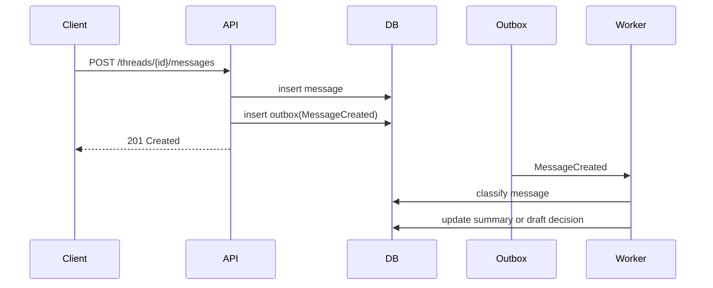
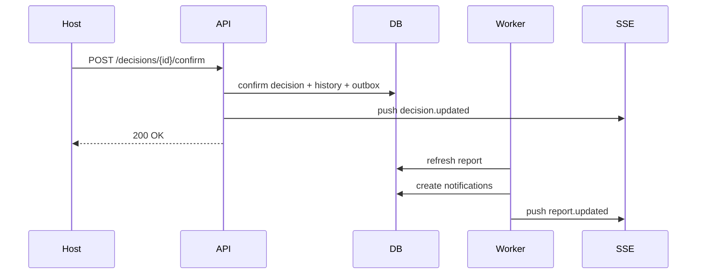

# API And Events

This document defines the MVP external API surface and internal async events.

## API Style

- REST for core domain operations
- SSE for room timeline updates
- JSON request and response bodies
- idempotency support for key mutation endpoints where retries are likely

## Versioning

- initial namespace: `/api/v1`
- breaking changes should use additive migration where possible during MVP

## Auth Model

- authenticated user session for full members
- invite token bootstrap for guest entry
- role enforcement at meeting scope

## Core Resources

- meetings
- invite-links
- memberships
- threads
- messages
- decisions
- votes
- reports
- search
- notifications

## Endpoint Draft

### Meetings

`POST /api/v1/meetings`

- create meeting

`GET /api/v1/meetings/{meetingId}`

- get meeting summary and progress

`PATCH /api/v1/meetings/{meetingId}`

- update title, budget, or high-level metadata

### Invites And Membership

`POST /api/v1/meetings/{meetingId}/invite-links`

- create invite link

`POST /api/v1/invite-links/{token}/join`

- join via invite

`PATCH /api/v1/meetings/{meetingId}/members/{memberId}`

- update role or attendance state

### Threads And Messages

`GET /api/v1/meetings/{meetingId}/threads`

- list threads with badges and activity state

`POST /api/v1/meetings/{meetingId}/threads`

- create thread

`GET /api/v1/threads/{threadId}/messages`

- list paginated messages

`POST /api/v1/threads/{threadId}/messages`

- post message

`PATCH /api/v1/messages/{messageId}`

- edit message

### Decisions

`GET /api/v1/meetings/{meetingId}/decisions`

- list decision board items

`POST /api/v1/meetings/{meetingId}/decisions`

- create manual or AI-originated draft decision

`GET /api/v1/decisions/{decisionId}`

- get decision detail with evidence and history

`POST /api/v1/decisions/{decisionId}/confirm`

- confirm decision

`POST /api/v1/decisions/{decisionId}/reconsider`

- reopen a confirmed decision with reason

### Votes

`POST /api/v1/meetings/{meetingId}/votes`

- create vote

`GET /api/v1/votes/{voteId}`

- get vote status and aggregated results

`PUT /api/v1/votes/{voteId}/responses/me`

- submit or replace caller responses

`POST /api/v1/votes/{voteId}/close`

- manually close vote

### Search And Reports

`GET /api/v1/meetings/{meetingId}/search?q=...`

- hybrid keyword and semantic search

`GET /api/v1/meetings/{meetingId}/reports/latest`

- get latest materialized report

`POST /api/v1/meetings/{meetingId}/reports/refresh`

- trigger report regeneration

### Realtime

`GET /api/v1/meetings/{meetingId}/events`

- SSE stream for room events

## Sample Shapes

### Create Meeting Request

```json
{
  "title": "2026 Summer Rafting",
  "meetingType": "trip",
  "expectedHeadcount": 9,
  "originRegion": "Daegu",
  "budget": {
    "min": 150000,
    "max": 200000
  }
}
```

### Decision Detail Response

```json
{
  "id": "decision_123",
  "meetingId": "meeting_123",
  "threadId": "thread_123",
  "decisionType": "date",
  "title": "Trip date",
  "status": "confirmed",
  "confirmedResult": {
    "startDate": "2026-07-18",
    "endDate": "2026-07-19"
  },
  "evidence": [
    {
      "id": "evidence_123",
      "messageId": "message_123",
      "evidenceType": "vote_result",
      "quoteSnapshot": "8 of 9 participants can attend on 7/18",
      "confidence": 0.98
    }
  ],
  "history": [
    {
      "action": "confirmed",
      "reason": "No hard conflicts remained",
      "createdAt": "2026-08-07T10:00:00Z"
    }
  ]
}
```

### Vote Submission Request

```json
{
  "responses": [
    {
      "optionId": "opt_0718",
      "responseValue": "available"
    },
    {
      "optionId": "opt_0719",
      "responseValue": "maybe"
    }
  ]
}
```

## Domain Events

Use an outbox-backed event stream. These events are internal contracts between the API transaction boundary and async workers.

### Core Events

- `MeetingCreated`
- `InviteLinkCreated`
- `MemberJoinedMeeting`
- `ThreadCreated`
- `MessageCreated`
- `MessageEdited`
- `VoteCreated`
- `VoteResponseUpserted`
- `VoteClosed`
- `DecisionDrafted`
- `DecisionConfirmed`
- `DecisionReconsiderationRequested`
- `SummaryGenerated`
- `ReportRefreshed`
- `NotificationRequested`

## Event Flows

### Message Flow



### Decision Confirmation Flow



## SSE Event Types

- `meeting.updated`
- `thread.updated`
- `message.created`
- `message.updated`
- `vote.updated`
- `decision.updated`
- `report.updated`
- `notification.created`

## Idempotency Guidance

Require idempotency keys for:

- create meeting
- create vote
- confirm decision
- refresh report

This reduces duplicate writes during mobile retry conditions.

## Error Semantics

- `400` invalid request shape or rule violation
- `401` unauthenticated
- `403` authenticated but lacking meeting role permission
- `404` resource not found or not visible
- `409` state conflict such as confirming an already superseded decision
- `422` semantically invalid transition

## Open API Follow-Up

Once implementation begins, convert this draft into a machine-readable OpenAPI spec and keep examples aligned with the scoring and state-machine rules.
