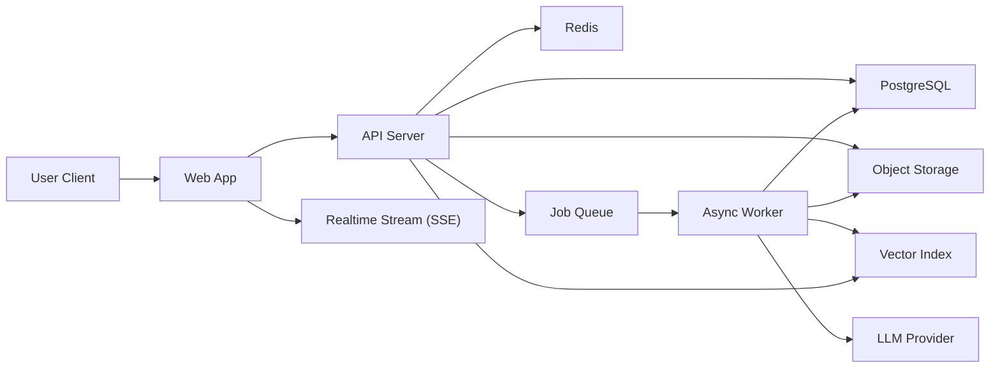
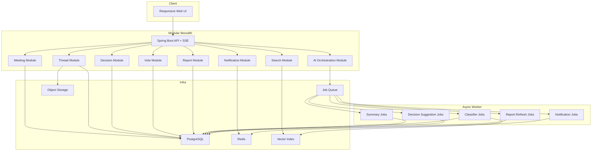

# Architecture Overview

This document defines the target MVP architecture for Dudecide.

## Goals

- optimize for rapid MVP delivery
- keep decision and evidence data first-class
- support realtime collaboration without early microservice complexity
- isolate AI and search work behind async boundaries
- preserve room for later settlement and booking extensions

## Recommended Stack Direction

### Client

- `Next.js` web-first responsive client for MVP
- optionally packaged later as React Native or native shell once usage is validated

### Backend

- `Kotlin + Spring Boot` modular monolith application
- REST API for core workflows
- SSE first for realtime room updates, with WebSocket as a later upgrade if needed
- async worker for AI, notifications, and report refresh

Current implementation snapshot:

- one Spring Boot application currently hosts meeting, thread, decision, vote, search, task, report, notification, and SSE endpoints
- SSE fan-out is in-memory and scoped to a single process
- scheduled outbox and notification workers now mark durable records as dispatched inside the monolith

### Data

- `PostgreSQL` for transactional source of truth
- `Redis` for rate limits, ephemeral presence, job queue coordination, and hot room state
- `pgvector` for semantic retrieval over message and summary embeddings
- S3-compatible object storage for attachments and exported reports

## Why Modular Monolith

The MVP's main risk is product validation, not horizontal scale. A modular monolith keeps domain boundaries explicit without forcing distributed-system costs too early.

Benefits:

- faster iteration on tightly coupled domains like messages, decisions, and votes
- simpler local development and testing
- easier transactional consistency for decision confirmation and evidence writes
- clean later extraction path for AI or search if needed
- Kotlin and Spring provide a stronger foundation for long-lived relational business logic

## Shared-Schema Strategy

The frontend and backend will not share runtime application code directly.

Shared contract rules:

- `OpenAPI` is the source of truth for HTTP request and response contracts
- backend DTOs and enums are authored in Kotlin first
- frontend API types and clients are generated from the published OpenAPI spec
- async worker payloads use explicit JSON contracts and documented event schemas
- AI structured outputs are validated on the backend before persistence

This keeps business ownership on the Kotlin side while preserving strong frontend type safety.

## System Context

## Logical Modules

### Identity And Access

- user profile
- invite token validation
- meeting membership
- role enforcement

Current implementation note:

- invite token validation and membership writes exist
- development-only header-based actor resolution exists through `LocalActorProvider`
- membership role enforcement exists for meeting-scoped reads and protected mutations
- production-grade authenticated sessions remain follow-up work

### Meeting Lifecycle

- create meeting
- manage meeting metadata
- track status and progress
- publish meeting report snapshots

### Discussion

- topic thread lifecycle
- message write and read
- thread activity summary
- thread-level status markers

### Decisions

- decision object lifecycle
- evidence linking
- decision history
- reconsideration flow

### Voting

- date availability matrix
- location package evaluation
- vote deadlines
- early-close resolution

### AI Assistance

- topic classification
- intent classification
- structured extraction
- summary generation
- decision suggestion generation

### Search And Reporting

- keyword retrieval
- semantic retrieval
- report materialization
- evidence-backed result composition

### Notification

- invite reminders
- vote nudges
- decision confirmation notifications
- stalled discussion nudges

## Internal Container View

## Realtime Strategy

For MVP, use SSE rather than WebSocket.

Reasons:

- one-way server push is enough for message, vote, and decision updates
- simpler operational model across mobile web and desktop web
- easier auth and reconnect behavior
- lower implementation complexity for early-stage product

Upgrade to WebSocket only if presence, typing, or heavy bidirectional signaling becomes important.

## Read/Write Model

### Write Path

1. client sends command to API
2. API validates membership and business rules
3. API writes transactional records to PostgreSQL
4. API emits domain event into queue or outbox
5. API pushes immediate room update to SSE subscribers

### Read Path

- canonical detail reads come from PostgreSQL
- search reads combine PostgreSQL metadata with vector matches
- report reads use precomputed snapshots with on-demand fallback regeneration

## Outbox Pattern

Use a database-backed outbox for async side effects.

Reasons:

- message writes must not lose downstream AI processing
- decision confirmations must reliably trigger report refresh and notifications
- event publication should remain consistent with transaction commits

Recommended implementation:

- Spring-managed transaction boundary
- PostgreSQL outbox table
- relay into worker queue after commit

Current implementation note:

- `outbox_event` writes are implemented
- relay workers and external queue publishing remain follow-up work

## Non-Goals For MVP

- independent deployable microservices
- event sourcing for the full domain
- CQRS read replicas beyond simple report snapshots
- financial transaction orchestration
- hard multi-tenant enterprise isolation

## Scaling Path

### First Scale Step

- move queue workers into separate deploy units
- isolate vector retrieval service if semantic search becomes expensive

### Second Scale Step

- split discussion and AI/search workloads
- add read-optimized caches for hot meetings

### Third Scale Step

- evaluate dedicated realtime gateway if concurrent room traffic becomes meaningful

## Security And Privacy Notes

- meeting data is private by default
- invite links should be revocable and optionally expire
- message content sent to AI providers must be auditable and minimized where possible
- evidence snapshots should preserve enough context for trust without leaking deleted content incorrectly
- generated frontend clients should be versioned against the OpenAPI contract to prevent silent drift
