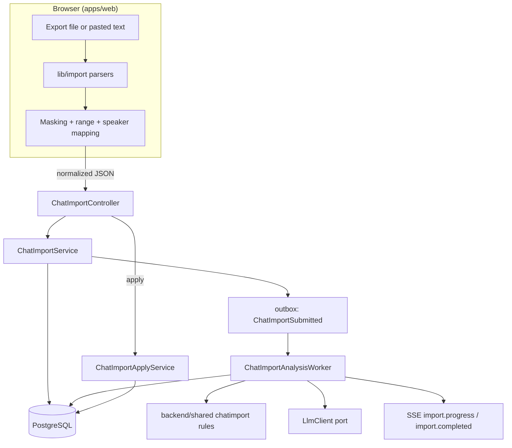
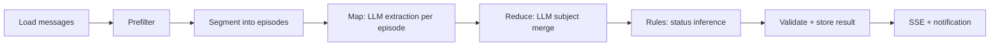

# Chat Import Design

Status: Accepted design, not implemented (2026-10-18).

Product plan: [`../product/chat-import-planning.md`](../product/chat-import-planning.md). Policy: [ADR 0005](../adr/0005-user-initiated-chat-import.md). AI rules: [ADR 0003](../adr/0003-ai-evidence-first-assistance.md), [`ai-pipeline.md`](./ai-pipeline.md).

## Scope

This design covers Phase 1 (import MVP) and leaves hooks for Phase 2 (re-import, prefilled votes). Phase 0 is a throwaway paste-only experiment: it reuses the client parser and one LLM call, persists nothing, and does not need the schema below.

## Key Design Choices

1. **Every import belongs to a meeting.** A guest import creates a meeting in `draft` status with the uploader as `host`. This reuses meeting-scoped auth, SSE, evidence, and reports instead of adding a meeting-less import object. "Convert" moves the meeting to `active`. Unconverted draft meetings are purged after 7 days.
2. **Parsing happens in the browser.** The server receives normalized, masked JSON only (ADR 0005).
3. **Imported messages are `message` rows** with `origin = 'imported'`, stored in one read-only thread per source room. Evidence, search, and reports keep working.
4. **Analysis results are staged, not applied.** The job writes an import result (`chat_import.result`). Decisions, tasks, and candidates are created only when the host applies selected items. This keeps the human gate and avoids filling an existing board with noise.
5. **Deterministic rules decide status; the LLM extracts.** The LLM labels messages and groups them into subjects. Pure Kotlin rules in `backend/shared` decide `likely_decided`, `contested`, and the rest. Rules are testable and do not drift with prompt changes.

## Component Overview



## Client (`apps/web`)

### Module Layout

```
apps/web/lib/import/
  types.ts            ParsedChat, ParsedMessage, ParseResult
  detect.ts           format detection from the first lines
  parsers/
    kakao-pc.ts
    kakao-android.ts
    kakao-ios.ts
    kakao-csv.ts
    free-text.ts      fallback: "name: message" lines, or one anonymous speaker
  mask.ts             sensitive pattern masking
  prefilter.ts        drop system lines, media placeholders, pure reactions
  normalize.ts        build the upload payload, assign pseudonyms
  __fixtures__/       anonymized real exports per format, version, locale
```

### Types

```ts
type ParsedMessage = {
  index: number;            // order in source
  speaker: string;          // display name as exported
  sentAt: string;           // ISO 8601 with offset; minute precision is normal
  body: string;
  kind: "text" | "media" | "system";
};

type ParseResult = {
  format: "kakao_pc" | "kakao_android" | "kakao_ios" | "kakao_csv" | "free_text";
  formatVersion: string;    // parser-internal pattern id, for telemetry
  roomName: string | null;
  messages: ParsedMessage[];
  unparsedLineCount: number;
};
```

### Parsing Rules

- Detection reads the header and first 50 lines and picks the parser with the highest match ratio. Below 60% match, fall back to `free_text`.
- Multi-line messages: a line that does not start a new message is appended to the previous message body.
- Dates: Korean (`2026년 10월 2일 오후 9:14`) and English locale variants, AM/PM markers in both languages, date-separator lines that set the current day.
- Timezone: assume the browser timezone (normally `Asia/Seoul`) and send ISO strings with offset.
- System lines (joins, leaves, invites, deleted messages) become `kind: "system"` and are not uploaded.
- Media placeholders (photo, video, emoticon, file) become `kind: "media"`; uploaded as a count per episode, not as messages.
- Exact line patterns are defined by the fixture corpus, not by this document. Every parser change needs a fixture.

### Masking

Applied to `body` before upload; each match is replaced with a typed token so the LLM still understands the context.

| Pattern | Token |
| --- | --- |
| Mobile and landline phone numbers | `[phone]` |
| Bank account numbers (digit groups with hyphens, 10-14 digits, near bank names or "account") | `[account]` |
| Card numbers (13-19 digits, Luhn-valid) | `[card]` |
| Resident registration numbers (`YYMMDD-NNNNNNN`) | `[rrn]` |
| Emails | `[email]` |

Masking errs toward over-masking. The wizard shows the masked count and a preview.

### Upload Payload

```json
{
  "source": {
    "type": "kakao_export",
    "format": "kakao_android",
    "formatVersion": "android-ko-2",
    "roomName": "Jeju trip"
  },
  "range": { "start": "2026-09-17T00:00:00+09:00", "end": "2026-10-17T23:59:00+09:00" },
  "speakers": [
    { "key": "s1", "displayName": "Minji", "isSelf": true, "membershipId": null },
    { "key": "s2", "displayName": "Junho", "isSelf": false, "membershipId": null }
  ],
  "messages": [
    { "speakerKey": "s1", "sentAt": "2026-10-02T21:14:00+09:00", "body": "Let's go with the 18th then" }
  ],
  "mediaCounts": [{ "date": "2026-10-02", "count": 14 }],
  "stats": { "parsedCount": 4120, "uploadedCount": 1830, "maskedCount": 3, "unparsedLineCount": 12 },
  "consent": { "isParticipant": true, "version": "chat-import-consent-v1" }
}
```

Limits enforced on both sides: 3,000 messages, 90-day range, 2 MB request body, 4,000 characters per message (truncate).

### Routes And Components

- `app/import/page.tsx`: guest entry wizard (creates a draft meeting)
- `app/meetings/[meetingId]/import/page.tsx`: import into an existing meeting
- `app/meetings/[meetingId]/import/[importId]/page.tsx`: progress and review
- `components/import/`: `import-dropzone`, `export-guide` (per OS), `range-picker`, `speaker-mapper`, `mask-preview`, `import-progress`, `import-review` (item list with evidence and apply checkboxes)
- Invite page (`app/invite/[token]/page.tsx`): report preview and "Which of these is you?" speaker claim after join

## Data Model

New migration `V3__chat_import.sql`. Also update the hand-written H2 schema in `AppServicesIntegrationTest` and [`database-schema.md`](./database-schema.md).

```sql
CREATE TYPE message_origin AS ENUM ('native', 'imported');

CREATE TYPE chat_import_source AS ENUM ('kakao_export', 'paste', 'screenshot', 'discord');

CREATE TYPE chat_import_status AS ENUM (
    'submitted',
    'analyzing',
    'ready',
    'applied',
    'failed',
    'deleted'
);

CREATE TABLE chat_import (
    id UUID PRIMARY KEY DEFAULT gen_random_uuid(),
    meeting_id UUID NOT NULL REFERENCES meeting(id) ON DELETE CASCADE,
    thread_id UUID NOT NULL REFERENCES topic_thread(id) ON DELETE CASCADE,
    uploaded_by_user_id UUID NOT NULL REFERENCES app_user(id),
    source_type chat_import_source NOT NULL,
    source_format VARCHAR(64) NOT NULL,
    source_room_name VARCHAR(200),
    range_start TIMESTAMPTZ NOT NULL,
    range_end TIMESTAMPTZ NOT NULL,
    message_count INTEGER NOT NULL CHECK (message_count >= 0),
    duplicate_count INTEGER NOT NULL DEFAULT 0,
    status chat_import_status NOT NULL DEFAULT 'submitted',
    progress JSONB NOT NULL DEFAULT '{}'::JSONB,
    result JSONB,
    stats JSONB NOT NULL DEFAULT '{}'::JSONB,
    consent_version VARCHAR(64) NOT NULL,
    prompt_version VARCHAR(64),
    model_versions JSONB NOT NULL DEFAULT '{}'::JSONB,
    failure_reason VARCHAR(200),
    purge_at TIMESTAMPTZ,
    created_at TIMESTAMPTZ NOT NULL DEFAULT NOW(),
    completed_at TIMESTAMPTZ,
    CONSTRAINT chat_import_range_ck CHECK (range_start <= range_end)
);

CREATE TABLE import_speaker (
    id UUID PRIMARY KEY DEFAULT gen_random_uuid(),
    meeting_id UUID NOT NULL REFERENCES meeting(id) ON DELETE CASCADE,
    thread_id UUID NOT NULL REFERENCES topic_thread(id) ON DELETE CASCADE,
    display_name VARCHAR(120) NOT NULL,
    pseudonym VARCHAR(32) NOT NULL,
    membership_id UUID REFERENCES membership(id) ON DELETE SET NULL,
    created_at TIMESTAMPTZ NOT NULL DEFAULT NOW(),
    CONSTRAINT import_speaker_thread_name_uk UNIQUE (thread_id, display_name),
    CONSTRAINT import_speaker_thread_pseudonym_uk UNIQUE (thread_id, pseudonym)
);

ALTER TABLE topic_thread ADD COLUMN read_only BOOLEAN NOT NULL DEFAULT FALSE;

ALTER TABLE message ALTER COLUMN sender_user_id DROP NOT NULL;
ALTER TABLE message ADD COLUMN origin message_origin NOT NULL DEFAULT 'native';
ALTER TABLE message ADD COLUMN import_id UUID REFERENCES chat_import(id) ON DELETE CASCADE;
ALTER TABLE message ADD COLUMN import_speaker_id UUID REFERENCES import_speaker(id) ON DELETE CASCADE;
ALTER TABLE message ADD COLUMN content_hash CHAR(64);
ALTER TABLE message ADD CONSTRAINT message_sender_origin_ck CHECK (
    (origin = 'native' AND sender_user_id IS NOT NULL AND import_speaker_id IS NULL)
    OR (origin = 'imported' AND sender_user_id IS NULL AND import_speaker_id IS NOT NULL
        AND import_id IS NOT NULL AND content_hash IS NOT NULL)
);

CREATE UNIQUE INDEX message_thread_content_hash_uk ON message (thread_id, content_hash)
    WHERE content_hash IS NOT NULL;
CREATE INDEX chat_import_meeting_idx ON chat_import (meeting_id, created_at DESC);
CREATE INDEX chat_import_purge_idx ON chat_import (purge_at) WHERE purge_at IS NOT NULL;

ALTER TYPE notification_type ADD VALUE 'import_ready';
```

Notes:

- `message.created_at` holds the original `sentAt` for imported rows so ordering, search recency, and evidence timestamps stay correct.
- `import_id ON DELETE CASCADE` on `message` plus the existing `decision_evidence.message_id ON DELETE CASCADE` and `task_item.source_message_id ON DELETE SET NULL` give the deletion behavior ADR 0005 requires.
- One import thread per `(meeting, source_room_name)`; re-imports reuse it and its speakers.
- `ALTER TYPE ... ADD VALUE` cannot run inside a transaction block on older PostgreSQL; keep it as the last statement and verify on the local stack.

### Content Hash

`sha256(speakerDisplayName + "\n" + sentAt truncated to minute + "\n" + normalizedBody + "\n" + occurrence)` where `occurrence` counts identical `(speaker, minute, body)` tuples within the upload. This keeps two real "ㅋㅋ" messages in the same minute while deduplicating overlapping re-imports. Computed on the server.

### Existing Code Impact

- `MeetingAccessService` (message edit permission) reads `SENDER_USER_ID` with `requireNotNull`: imported messages must be rejected as not editable before that check.
- `MessageService` create path stays `native`; posting into a `read_only` thread returns `422`.
- Message views gain `origin`, `speaker` (display name or pseudonym per visibility rules), and nullable `senderUserId`.
- `MeetingService` thread listing exposes `readOnly` and keeps import threads after default threads in `sort_order`.

## Import Result Shape

Stored in `chat_import.result` and returned by the API. Every item carries evidence message ids.

```json
{
  "schemaVersion": "chat-import-result-v1",
  "items": [
    {
      "itemId": "it_1",
      "kind": "decision",
      "status": "likely_decided",
      "decisionType": "date",
      "title": "Trip date",
      "proposedResult": { "date": "2026-10-18" },
      "options": [],
      "evidence": [
        { "messageId": "…", "role": "proposal" },
        { "messageId": "…", "role": "support" },
        { "messageId": "…", "role": "confirmation" }
      ],
      "objections": [],
      "confidence": 0.88
    },
    {
      "itemId": "it_2",
      "kind": "decision",
      "status": "contested",
      "decisionType": "location",
      "title": "Lodging area",
      "options": [
        { "label": "Aewol", "supporters": 2, "objectors": 1 },
        { "label": "Seogwipo", "supporters": 2, "objectors": 0 }
      ],
      "evidence": [{ "messageId": "…", "role": "opposition" }],
      "confidence": 0.74
    },
    { "itemId": "it_3", "kind": "open_question", "title": "Who is renting the car?", "evidence": [{ "messageId": "…", "role": "question" }] },
    { "itemId": "it_4", "kind": "task", "title": "Book the ferry", "ownerSpeakerId": "…", "evidence": [{ "messageId": "…", "role": "task" }] }
  ],
  "candidates": { "dates": ["2026-10-18", "2026-10-25"], "locations": ["Aewol", "Seogwipo"] },
  "digest": "Two-paragraph narrative summary with message references."
}
```

## Analysis Job

### Placement

Phase 1 runs inside `backend/app` as `domain/chatimport/ChatImportAnalysisWorker`, a scheduled poller over `outbox_event` (`ChatImportSubmitted`) like the existing `OutboxRelayWorker`. Pure logic lives in `backend/shared`. Move the job to `backend/worker` when load or isolation needs it; the `LlmClient` port keeps that move mechanical.

### Stages



1. **Prefilter (`shared`, `ChatPrefilter`).** Exclude pure laughter, emoji or punctuation only messages, and messages under 2 visible characters from LLM input; keep them as counts on the episode. Stance reactions (`ㅇㅇ`, `응`, `콜`, `ㄱㄱ`, `ㄴㄴ`, `반대`) are always kept because they are support or opposition evidence.
2. **Segment (`shared`, `EpisodeSegmenter`).** New episode on a gap of 3 hours or more, or a date change with a gap of 1 hour or more. Split episodes over 150 messages at the largest internal gap. Merge episodes under 5 messages into the neighbor with the smaller time gap. Order: boundary split, small merge, then oversized split, where the split point keeps both sides at 5+ messages.
3. **Map (LLM, fast tier).** Per episode, return per-message labels and local subjects. Episodes run in parallel with a concurrency cap of 4.
4. **Reduce (LLM, strong tier).** Input: all local subjects with their message ids and timestamps, never full message text beyond quotes already selected. Output: global subjects with an ordered event list.
5. **Rules (`shared`).** Turn global subjects into result items (below).
6. **Validate.** Reject unknown message ids, empty evidence, and schema violations. One retry with the validation error appended; then mark the item dropped and continue. The import fails only if map fails for more than 20% of episodes.

Progress is written to `chat_import.progress` (`{ "stage": "map", "done": 7, "total": 12 }`) and pushed as SSE.

### LLM Contracts

Prompts live in code with explicit versions (`chat-import-map-v1`, `chat-import-reduce-v1`). Inputs use pseudonyms and message ids only.

Map output per episode:

```json
{
  "messages": [
    { "id": "m_102", "topics": ["date"], "intents": ["proposal"], "entities": { "dates": ["2026-10-18"] } }
  ],
  "subjects": [
    {
      "localKey": "date-1",
      "decisionType": "date",
      "title": "Trip date",
      "events": [
        { "messageId": "m_102", "speaker": "Speaker A", "kind": "proposal", "option": "2026-10-18" },
        { "messageId": "m_105", "speaker": "Speaker C", "kind": "support", "option": "2026-10-18" }
      ]
    }
  ],
  "questions": [{ "messageId": "m_110", "answeredBy": null }],
  "tasks": [{ "messageId": "m_120", "title": "Book the ferry", "acceptedBy": "Speaker B" }]
}
```

Reduce output: `subjects` with a stable `subjectKey`, merged `events` ordered by time, and `mergedFrom` local keys. Event kinds: `proposal`, `support`, `opposition`, `condition`, `confirmation`, `withdrawal`.

### Status Inference Rules

Implemented in `backend/shared/src/main/kotlin/com/dudecide/shared/chatimport/SubjectStatusRules.kt`. Per subject, per option:

- **Option attribution:** an event without an option applies to the current option, set by the latest `proposal`, `support`, or `confirmation` that names one. `opposition` naming an option does not move focus.
- **Stance:** per `(speaker, option)`, the latest of `proposal` / `support` / `confirmation` (supporter), `opposition` (objector), or `withdrawal` (neutral). `condition` is evidence only and does not change stance. A speaker may support several options; moving on is expressed through `superseded`.
- **Active speakers** of a subject: distinct speakers with at least one event in it.
- **Leading option:** most distinct supporters (proposer counts as a supporter); ties broken by latest support.
- **`likely_decided`** when the leading option has a `confirmation` event, or support from at least 2 distinct speakers and at least half of active speakers; **and** no `opposition` or competing `proposal` on that subject after the last confirmation or support.
- **`superseded`** for an option when a later option becomes leading; kept as evidence on the item.
- **`contested`** when two or more options each have 2+ supporters, or an `opposition` follows the leading option's last support.
- **`abandoned`** when a subject has only proposals from a single speaker and the last one is at least 72 hours before the import range end. Shown in the report, not offered for apply.
- Otherwise **`open`** (discussed, not decided).
- Confidence is the minimum of LLM label confidence on the deciding events, capped at 0.6 for `likely_decided` items with no explicit `confirmation`.
- Ambiguity bias: when rules disagree, prefer `contested` over `likely_decided`.

Questions with `answeredBy = null` become `open_question` items. Tasks become `task` items; `ownerSpeakerId` only when `acceptedBy` is set.

### Model Configuration

```yaml
dudecide:
  ai:
    provider: fake          # fake | openai | anthropic
    map-model: ""           # fast tier
    reduce-model: ""        # strong tier
    timeout-seconds: 60
    max-concurrency: 4
```

The `fake` provider returns deterministic fixtures and is the default for local development and tests. `backend/worker` already declares `openai-java`; provider choice stays configuration, not code.

## Applying Results

`POST /api/v1/imports/{importId}/apply` with selected `itemIds`. In one transaction:

| Item | Becomes |
| --- | --- |
| `likely_decided` decision | `decision` with status `proposed`, `proposed_result` set, history `drafted`, evidence rows with `quote_snapshot` |
| `contested` / `open` decision | `decision` with status `in_discussion`; options kept in `proposed_result.options` for later vote prefill |
| `task` | `task_item` with `source_message_id`; `owner_user_id` only if the owner speaker is mapped |
| `open_question` | stays in the report only |

- Decisions go into the meeting's default thread for their `decisionType`; evidence rows point at the import thread's messages.
- Evidence `evidence_type` maps from event kind (`question` and `task` evidence are not stored as decision evidence).
- `quote_snapshot` uses the speaker label visible at apply time (see Visibility).
- A draft meeting moves to `active` and its import's `purge_at` is cleared.
- Re-apply of an item is idempotent via `Idempotency-Key` and a per-import `appliedItemIds` list in `result`.
- Report refresh is requested through the existing outbox path.

## Visibility

- Speaker label: member display name if `membership_id` is set, else `pseudonym` (`Participant B`).
- The uploader always sees real display names (they uploaded them).
- Other members see the label rule above. Hosts can map speakers to members.
- Invite preview (no membership yet): item titles, statuses, open counts; no quotes, no speaker labels.

## API

All under `/api/v1`. DTOs first, then `contracts/openapi/dudecide-openapi-v1.yaml`, then `apps/web/lib/api/`.

| Method and path | Purpose | Access |
| --- | --- | --- |
| `POST /imports` | create draft meeting + import from payload | any session (guest ok) |
| `POST /meetings/{meetingId}/imports` | import into existing meeting | `host`, `co_host` |
| `GET /meetings/{meetingId}/imports` | list imports | member |
| `GET /imports/{importId}` | status, progress, result | member |
| `POST /imports/{importId}/apply` | apply selected items | `host`, `co_host` |
| `DELETE /imports/{importId}` | delete import, its messages, dependent evidence | uploader or `host` |
| `GET /meetings/{meetingId}/import-speakers` | list speakers with mapping | member |
| `PATCH /import-speakers/{speakerId}` | set or clear `membershipId` | `host`, `co_host` |
| `POST /import-speakers/{speakerId}/claim` | current member claims an unmapped speaker | member, once per meeting |
| `GET /invite-links/{token}/preview` | meeting title + report preview without quotes | public with valid token |

Responses:

- `POST` import endpoints return `202 Accepted` with `{ importId, meetingId, status, duplicateCount }`.
- `Idempotency-Key` supported on both create endpoints and on apply.
- Errors: `400` payload invalid or over limits (with `limit` field), `409` apply on an import not `ready`, `422` write into a read-only thread, `429` daily import limit.
- `DELETE` response includes `{ removedMessages, removedEvidence, affectedConfirmedDecisions }`; the UI shows the last count in the confirm dialog via a dry-run `GET /imports/{importId}?includeDeletionImpact=true`.

### Events

Domain events (outbox): `ChatImportSubmitted`, `ChatImportCompleted`, `ChatImportFailed`, `ChatImportApplied`, `ChatImportDeleted`, `ImportSpeakerMapped`.

SSE types (meeting stream): `import.progress`, `import.completed`, `import.failed`. `import.completed` also creates an `import_ready` notification for the uploader.

## Limits And Abuse Controls

- Per actor: 3 imports per day; per meeting: 10 per day. Redis counters keyed by date; in-memory fallback for local runs.
- Server re-checks payload limits and rejects bodies over 2 MB before parsing.
- Re-import into an existing meeting: `host` and `co_host` only.

## Retention Jobs

- `ChatImportPurgeWorker` (scheduled, hourly): delete meetings still in `draft` whose import has `purge_at < now()`.
- `purge_at` is set to `created_at + 7 days` for imports that create a draft meeting, and cleared on apply.
- Deleted imports keep a tombstone row (`status = 'deleted'`, `result = NULL`, stats only) for metrics.

## Telemetry

- Client sends parse telemetry only: `format`, `formatVersion`, `parsedCount`, `unparsedLineCount`, and a failure signature (line shape such as `D+. D+. D+. W D+:D+, *`), never content.
- Server records stage durations, token usage per stage, dropped items, and apply ratio per item status.
- Product metrics are listed in the product plan.

## Testing

- **Parsers and masking:** Vitest over `__fixtures__`, one fixture per format, version, and locale; property tests for masking (no digits run of 10+ survives unmasked next to account keywords).
- **Rules:** `backend/shared` unit tests for segmentation, prefilter, and every status rule, including tie and late-objection cases.
- **Backend integration:** H2 tests with the `fake` LLM provider for create, analyze, apply, delete, purge, dedupe on re-import, and the `message_sender_origin_ck` constraint.
- **Evaluation:** offline harness over the labeled chat set (product plan) reporting decision precision, recall, and false-decided rate per prompt version; run before any prompt or model change.
- **E2E:** Playwright paste flow with the fake provider: paste, map speakers, analyze, apply, invite preview.

## Implementation Order

Each step is one commit-sized work unit.

1. `backend/shared`: prefilter, segmentation, status rules with tests.
2. Migration `V3__chat_import.sql`, H2 test schema, jOOQ regen, `database-schema.md`.
3. Nullable sender handling in message views and access checks; read-only thread enforcement.
4. `ChatImportService` create endpoints, content hash, dedupe, DTOs, OpenAPI.
5. `LlmClient` port with `fake` provider, analysis worker, progress SSE.
6. Apply, delete, speaker mapping and claim endpoints.
7. Web: `lib/import` parsers, masking, fixtures.
8. Web: import wizard, progress, review, apply.
9. Web: invite preview and speaker claim.
10. Purge worker, rate limits, telemetry.
11. Real LLM provider adapter and evaluation harness.
