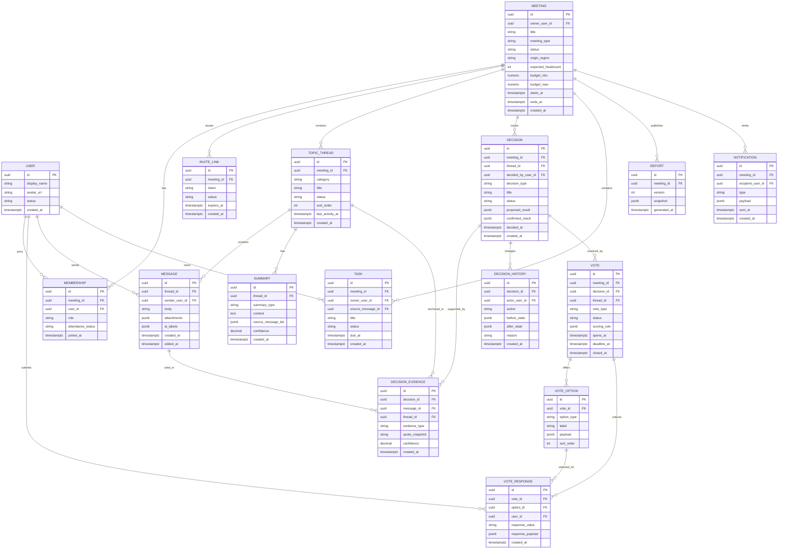

# Data Model And ERD

This document defines the MVP data model and its near-term extensions.

## Modeling Principles

- decisions are first-class entities, not derived UI artifacts
- evidence links must survive summary regeneration
- votes are generic enough to support both date matrices and package evaluations
- reports are materialized outputs, not the sole source of truth

## Core ERD



## Entity Notes

### User

- one identity across many meetings
- guest flows can later map temporary invite visitors into full users

### Meeting

- top-level aggregate for product experience
- stores coarse planning metadata only
- decision progress should be derived, not manually edited

### Membership

- role lives at meeting scope
- supports `host`, `co_host`, `participant`, `guest`

### TopicThread

- default categories for MVP: `date`, `location`, `lodging`, `transport`, `free_chat`
- status can reflect `active`, `blocked`, `waiting_on_dependency`, `closed`

### Message

- raw discussion source of truth
- `ai_labels` stores latest inferred topic and intent tags for fast UI display
- richer extraction artifacts should live in dedicated tables or search indexes, not only here

### Decision

- one record per discrete planning outcome or pending item
- `proposed_result` is editable draft state
- `confirmed_result` is authoritative once confirmed

### DecisionEvidence

- critical trust object
- quote snapshot preserves historical evidence even if message rendering later changes
- message_id remains canonical backlink target

### Vote

- generic vote container
- `vote_type` examples: `date_matrix`, `package_preference`, `binary_confirm`
- `scoring_rule` stores algorithm version and weights

### VoteOption

- payload differs by vote type
- date options store date metadata
- package options store region, activity, cost, and pros/cons

### VoteResponse

- for date matrix, one user creates one response per date option
- for package preference, one user creates one response per package option
- `response_value` examples: `available`, `maybe`, `unavailable`, `good`, `okay`, `dislike`

### Summary

- thread-level summary snapshots
- not authoritative over decisions
- can be regenerated safely as long as source links remain stable

### Report

- meeting-level materialized output
- stores generated snapshot for fast reads and sharing

## State Enums

### Meeting Status

- `draft`
- `active`
- `finalizing`
- `completed`
- `archived`

### Decision Status

- `proposed`
- `in_discussion`
- `voting`
- `confirmed`
- `on_hold`
- `needs_reconsideration`

### Vote Status

- `draft`
- `open`
- `closed`
- `superseded`

## Example Vote Payloads

### Date Option Payload

```json
{
  "date": "2026-07-18",
  "is_weekend": true,
  "label": "Sat 7/18"
}
```

### Location Package Payload

```json
{
  "region": "Sancheong",
  "activity": "rafting",
  "travel_minutes": 120,
  "budget_min": 180000,
  "budget_max": 220000,
  "pros": ["strong activity fit", "valley atmosphere"],
  "cons": ["driving burden"]
}
```

## Search Projection

The semantic search layer should maintain a denormalized document per searchable unit:

- message document
- summary document
- decision document
- report section document

Each document should keep:

- meeting_id
- thread_id if present
- source entity id
- source entity type
- plain text
- tags
- embedding vector

## Future Extensions

Likely next entities after MVP:

- AttendanceInterval
- Expense
- ExpenseParticipant
- SettlementPlan
- DepositPolicy
- ReservationReference
