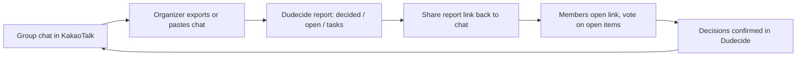

# Chat Import Planning

Status: Accepted (2026-10-18). Extends [`dudecide-codex-prd.md`](./dudecide-codex-prd.md); does not change the existing exclusion of KakaoTalk crawling or unofficial API sync.

Policy: [ADR 0005](../adr/0005-user-initiated-chat-import.md). Technical design: [`chat-import-design.md`](../engineering/chat-import-design.md).

## Why This Matters

The current MVP asks a whole friend group to move planning into Dudecide. That is the biggest adoption risk already listed in the PRD ("separate-app adoption friction"). Most groups will keep talking in KakaoTalk no matter what we ship.

Chat import flips the entry point:

- **Before:** "Move your group here, then we structure the conversation."
- **After:** "Bring the chat you already had. We hand back decisions, open items, and a report in about a minute."

Two consequences:

1. **Single-player value.** The organizer gets value alone, before inviting anyone. This removes the cold-start problem of a group tool.
2. **Built-in acquisition loop.** The report is shared back into the original chat room, and members join to resolve what is still open.



Positioning update:

`Paste your group chat. Get what was decided, what is still open, and who owes what, with the receipts.`

## Reality Check: What Can Be Imported

| Channel | Official path | Realtime | Effort | Priority |
| --- | --- | --- | --- | --- |
| KakaoTalk chat export (`.txt` / `.csv`) | Yes, user-initiated "export chat" in room settings | No | Parser per OS/version/locale | P0 |
| Copy-paste of chat text | Yes (clipboard) | No | Heuristic + LLM-assisted parsing | P0 |
| Screenshots | Yes (images) | No | Vision/OCR, error-prone | P2 |
| Android share sheet (PWA Web Share Target) | Yes | No | Manifest `share_target`; not supported on iOS Safari | P2 |
| iOS share extension | Yes | No | Requires native shell | P3 |
| Discord bot | Yes, official bot API | Yes | Bot + OAuth install | P3 |
| Telegram / LINE / Slack bots | Yes, official APIs | Yes | Per-platform bot | Later |
| KakaoTalk group-chat bot / message API | No general read access to group chats | - | - | Not planned |
| Crawling, Android accessibility scraping, unofficial clients | Violates platform terms, account-ban risk | - | - | Never |

Key conclusions:

- For KakaoTalk, **user-initiated export and paste are the only realistic and compliant paths.** Design the UX so that this feels like one step, not a chore.
- Export formats differ by platform (PC, Android, iOS), app version, and locale (date formats, AM/PM markers, system messages). The parser needs a fixture corpus and tolerant fallbacks, not one regex.
- Realtime sync is only realistic on platforms with official bot APIs. Discord fits hobby communities, which are a primary target segment.

## User Flow (P0)

1. **Entry.** Landing CTA "Paste a chat" works without sign-up (guest session already exists). Also available inside an existing meeting as "Import chat".
2. **Input.** Drop a KakaoTalk export file or paste text. Show a short visual guide for each OS's export menu.
3. **Local parse and preview (in browser).** Show detected room name, period, message count, and speakers. Parse failures fall back to "free text" mode instead of blocking.
4. **Scope.** Choose a date range (default: last 30 days or since last import). Long chats are trimmed here, which also reduces cost and privacy exposure.
5. **Speaker mapping.** List detected speakers. Optionally map each to an existing member or mark "me". Unmapped speakers stay as imported aliases.
6. **Privacy step.** Sensitive patterns (phone numbers, bank account numbers, resident registration numbers, emails) are masked before upload. The uploader confirms they are a participant of the chat and that it will be used to organize this meeting.
7. **Analysis (async).** Progress via SSE. Target: under 60 seconds for 2,000 messages.
8. **Review.** Result screen with:
   - likely decided items (draft decisions, need host confirmation)
   - contested items (options with support and opposition)
   - open questions nobody answered
   - tasks with inferred owners
   - extracted date and location candidates
   - every item shows evidence quotes with original sender and timestamp
9. **Convert.** One tap turns the result into a meeting: draft decisions on the board, candidates prefilled into the availability matrix or location comparison, tasks created.
10. **Share back.** Share the report link to KakaoTalk (Kakao share SDK or copy link with OG card). The card states what is still open, e.g. "2 items need your vote".

### Re-import

Groups keep chatting. Re-import must be cheap:

- remember the last imported timestamp per meeting and default the range to "since last import"
- deduplicate on `(sent_at, speaker, body hash)`
- run analysis on the delta, merged with existing decisions: new evidence attaches to existing decisions, contradictions move a confirmed item to `needs reconsideration` as a suggestion, never silently

## Analysis Output

Reuses the existing AI pipeline (topic, intent, extraction, summary, decision suggestion). Import-specific additions:

- **Decision status inference:** `likely_decided` (explicit agreement, no later objection), `contested`, `abandoned` (proposal with no follow-up), `superseded` (a later message replaced it).
- **Recency rule:** later messages override earlier ones on the same subject; the report shows the override chain as evidence.
- **Minority preservation:** objections remain visible on decided items (ADR 0003).
- **Task owner inference:** only when a speaker explicitly accepts ("I'll book it"); otherwise the task stays unassigned.

AI never confirms anything. Every imported item lands as `proposed` with evidence until a host confirms it.

## Privacy And Legal

The uploader shares other people's messages. This is the most sensitive part of the feature and needs explicit design, not a checkbox.

Rules:

- **Parse in the browser.** The raw export file never leaves the device. Only the selected range, normalized and masked, is uploaded.
- **Mask before upload.** Phone numbers, bank account numbers, resident registration numbers, card numbers, emails. Bank account numbers are common in Korean group chats because of settlements.
- **Pseudonymize for the model.** Speakers are sent to the LLM as `Speaker A`, `Speaker B`; names are re-attached on our side.
- **Retention.** Imported messages live only as long as the meeting. Guest imports without a meeting are purged after 7 days. The uploader can delete an import at any time, which removes its messages and any evidence that depends on them.
- **No training use** of imported content; disclose the LLM provider and cross-border processing in the privacy policy.
- **Visibility.** The shared link is an invite link. Before joining, it shows item titles and status only, no quotes. After joining, quotes show real names only for speakers who are mapped to a member; others stay pseudonymized (see Product Decisions).
- **Legal review** under the Personal Information Protection Act before public launch, especially for the guest flow and the share link.

These rules are recorded in [ADR 0005](../adr/0005-user-initiated-chat-import.md).

## Technical Design Sketch

### Client (`apps/web`)

- `lib/import/`: pure TypeScript parsers per format (`kakao-pc`, `kakao-android`, `kakao-ios`, `kakao-csv`, `free-text`), each returning a normalized `ParsedChat`. Unit-tested against a fixture corpus of anonymized real exports.
- Masking utility with Vitest coverage for Korean number formats.
- Import wizard route: `app/import/` (guest) and `app/meetings/[meetingId]/import/`.

Normalized upload shape:

```json
{
  "sourceType": "kakao_export",
  "sourceRoomName": "Jeju trip",
  "periodStart": "2026-09-01T00:00:00+09:00",
  "periodEnd": "2026-10-17T23:59:00+09:00",
  "speakers": [{ "alias": "Speaker A", "displayName": "Minji", "membershipId": null }],
  "messages": [{ "speaker": "Speaker A", "sentAt": "2026-10-02T21:14:00+09:00", "body": "Let's go with the 18th then" }]
}
```

### Backend

Schema (new Flyway migration, never edit V1):

- `chat_import` (`id`, `meeting_id`, `uploaded_by_user_id`, `source_type`, `source_room_name`, `period_start`, `period_end`, `message_count`, `status`, `purge_at`, `created_at`)
- `import_speaker` (`id`, `meeting_id`, `display_name`, `pseudonym`, `membership_id` nullable)
- `message` changes: `sender_user_id` becomes nullable, add `origin` (`native` | `imported`), `import_id`, `import_speaker_id`, `content_hash`; check constraint that exactly one of `sender_user_id` / `import_speaker_id` is set; unique `(thread_id, content_hash)` for dedupe

Keeping imported content in `message` means evidence, search, summaries, and reports work without a parallel model. Imported messages go into a per-import thread (`free_chat` category) and are linked to topics through `ai_labels`.

API (update DTOs, OpenAPI, and `apps/web/lib/api/` together):

- `POST /api/v1/imports`: create guest import, optionally creating a meeting
- `POST /api/v1/meetings/{meetingId}/imports`: import into an existing meeting
- `GET /api/v1/imports/{importId}`: status and result
- `POST /api/v1/imports/{importId}/convert`: materialize decisions, candidates, tasks
- `DELETE /api/v1/imports/{importId}`: delete import and dependent evidence
- SSE events: `import.progress`, `import.completed`, `import.failed`

### Analysis Job (worker)

Long chats do not fit one prompt, and most messages are chatter.

1. **Prefilter** without an LLM: drop system lines, media placeholders, pure emoji or laughter, very short reactions. Keep them only as context counts.
2. **Segment** by time gaps and day boundaries into conversation episodes.
3. **Map:** per-episode extraction (topics, proposals, support, objections, confirmations, tasks, entities) with message ids. A small, fast model tier is enough here.
4. **Reduce:** merge across episodes, resolve the same subject over time, apply recency rules, produce decision suggestions with evidence. Use a stronger model tier.
5. **Validate** structured output on the backend before persistence (existing rule), then emit report data.

Cost guardrails: per-import message cap (e.g. 5,000 after prefilter for free usage), per-user daily import limit via Redis, and caching of episode results for re-import.

### Evaluation

Build a labeled set of 30+ synthetic and consented Korean group chats with gold decisions, open items, and tasks. Track decision precision and recall, evidence correctness, and false "decided" rate before each prompt or model change. A false "decided" is worse than a miss.

## Delivery Phases

### Phase 0: Demand Validation (1-2 weeks)

- Landing CTA "Paste your KakaoTalk chat to get a decision summary" plus a minimal paste-only flow, single LLM call, capped at a few hundred messages, no persistence.
- Share in Phase 0 means copying a plain-text summary back to the chat (no meeting, no link).
- Measure: CTA click rate, paste completion rate, "this is accurate" rating, share rate.
- Go/no-go thresholds are in Product Decisions below; below them, stop before building the full pipeline.

### Phase 1: Import MVP

- KakaoTalk export parsers (PC, Android, iOS) and free-text paste
- client-side masking, speaker mapping, range selection
- async analysis with evidence, review screen, convert-to-meeting
- share-back link with OG card
- delete import, retention purge job

### Phase 2: Loop Strengthening

- incremental re-import with dedupe and delta analysis
- prefilled votes from extracted candidates
- Android PWA share target
- screenshot import (vision) for short spans

### Phase 3: Live Channels

- Discord bot for hobby communities (opt-in per channel, official API)
- iOS share extension once a native shell exists
- evaluate Telegram and LINE based on user demand

### Never

- KakaoTalk crawling, unofficial clients, Android accessibility-service scraping
- auto-posting into chat rooms without a user action

## Success Metrics

- import start to report completion rate
- parse success rate by source format
- time to first report
- draft decision acceptance rate and false "decided" rate
- report share-back rate
- share link to member join conversion (viral coefficient)
- re-import rate within 14 days
- import-originated meetings that reach a confirmed decision

## Risks

- **Parser breakage** when KakaoTalk changes its export format. Mitigate with a fixture corpus, format telemetry (anonymized failure signatures), and the free-text fallback.
- **AI accuracy.** A wrong "decided" item damages trust more than a missing one. Bias toward `contested` when unsure and always show evidence.
- **Privacy backlash** from non-uploading members. Mitigate with masking, pseudonymized sharing, easy deletion, and clear copy.
- **LLM cost** on very long chats. Mitigate with prefiltering, range defaults, and caps.
- **One-shot usage.** Users may import once and never return. Re-import and open-item voting are the retention hooks; watch the 14-day re-import metric.

## Product Decisions

Recommended answers to the earlier open questions, accepted for Phase 0 and Phase 1. Revisit with Phase 0 data.

### Guest access to the report

- The full report is visible to a guest session without sign-up. Value first; the existing guest session is enough.
- Converting to a meeting and sharing back require only the same guest session. The uploader becomes the meeting `host`.
- Account linking (real sign-in) is prompted after conversion, when the user has something to lose.

### Quotes in the shared link

- The share link is the meeting invite link with a report preview, not a public report URL.
- Before joining: item titles, statuses, and counts ("2 items need your vote"). No quotes, no names.
- After joining: evidence quotes are visible to members. A speaker's real display name is shown only when that speaker is mapped to a member; otherwise the pseudonym (`Participant B`) is shown.
- Joining members are asked "Which of these is you?" and can claim one unmapped speaker. The host can correct mappings.

### Imported messages in the UI

- Imported messages live in one read-only thread per source room ("가져온 대화: <room name>"), collapsed by default.
- Their main surface is evidence behind decisions, open items, and tasks. Imported messages cannot be edited or replied to.

### Usage caps (free tier)

- Range: up to 90 days per import, default 30 days or since the last import.
- Size: up to 3,000 messages after prefiltering per import.
- Rate: 3 imports per actor per day, 10 per meeting per day.
- Over the cap, the wizard asks the user to narrow the range instead of failing.

### Phase 0 go/no-go

Proceed to Phase 1 when, over at least 100 paste starts:

- paste-to-report completion rate is at least 60%
- "this is accurate" rating is at least 70%
- report share rate is at least 25%

## Open Questions

- Should a re-import by a non-host member be allowed, or host and co-host only? Default: host and co-host only.
- Is 7-day guest retention short enough for the legal review?
